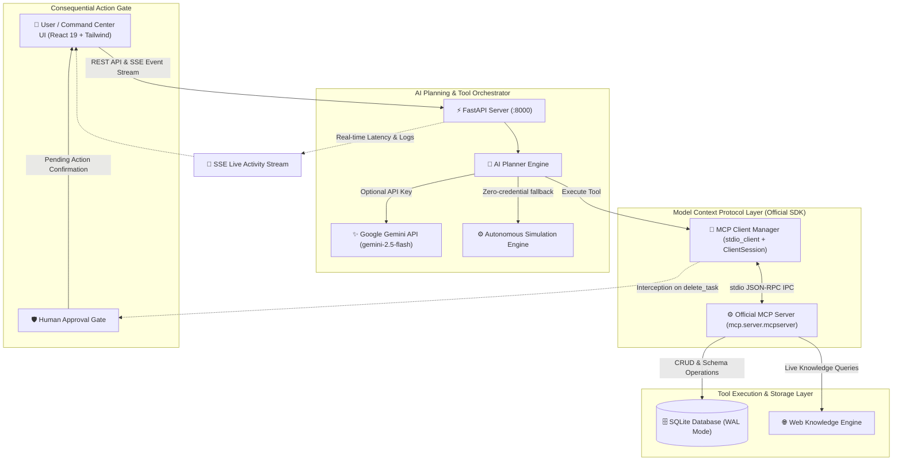

<div align="center">


# 🚀 LifePilot AI — Your Personal AI Command Center
### *Autonomous Goal Planning, Official Model Context Protocol (MCP) Tool Integration, and Persistent Local Command Center*

[](https://modelcontextprotocol.io/)
[](https://python.org)
[](https://fastapi.tiangolo.com)
[](https://react.dev)
[](https://tailwindcss.com)
[](https://sqlite.org)
[](https://cloud.google.com/run)

<p align="center">
  <b>LifePilot AI</b> is an intelligent, agentic personal operations platform built for the <b>Google Build with Gemini</b> initiative. Rather than simply generating static conversational text, LifePilot translates natural-language goals into structured execution workflows, communicates with external tools via the <b>official Model Context Protocol (MCP)</b> over standard <code>stdio</code> IPC, enforces <b>human approval gates</b> for consequential actions, and provides a futuristic dark navy command dashboard.
</p>

</div>

---

## 📑 Table of Contents

- [🌟 System Architecture](#-system-architecture)
- [🛠️ Registered MCP Tools Catalog](#️-registered-mcp-tools-catalog)
- [🛡️ Human-in-the-Loop Safeguards](#️-human-in-the-loop-safeguards)
- [🖥️ Command Center Dashboard Features](#️-command-center-dashboard-features)
- [🎯 Featured Scenario: 7-Day AI Engineer Interview Prep](#-featured-scenario-7-day-ai-engineer-interview-prep)
- [📁 Project Organization](#-project-organization)
- [🚀 Quick Start & Local Run](#-quick-start--local-run)
- [🧪 Isolated MCP Protocol Testing](#-isolated-mcp-protocol-testing)
- [☁️ Containerization & Cloud Run Deployment](#️-containerization--cloud-run-deployment)
- [🔬 Automated Test Suite](#-automated-test-suite)
- [📄 License & Acknowledgments](#-license--acknowledgments)

---

## 🌟 System Architecture

LifePilot AI implements a strict separation of concerns between client orchestration, transport protocols, AI planning engines, and persistent storage:



### Key Technical Pillars:
1. **Official Python MCP SDK (v2.3.0)**: Built directly with `mcp.server.mcpserver.MCPServer` and `mcp.client.stdio.stdio_client`. No mocked protocol layers or simulated schemas.
2. **Persistent Storage (SQLite WAL Mode)**: Multi-process concurrency-safe SQLite database with Write-Ahead Logging (`PRAGMA journal_mode=WAL; PRAGMA busy_timeout=5000;`). Tasks, execution traces, and approvals survive process restarts.
3. **Dual-Mode AI Engine**:
   - **Google Gemini API Mode**: Supports `gemini-2.5-flash` or `gemini-1.5-pro` with dynamic function declarations and multi-turn tool calling.
   - **Autonomous Simulation Engine**: When running without credentials, a rule-based orchestrator selects real MCP tools, decomposes milestones, and executes database writes with zero fake or hardcoded output.
4. **Live Activity Telemetry**: Server-Sent Events (SSE) stream every tool start, completion status, execution latency (in milliseconds), arguments, and structured responses directly to the UI.

---

## 🛠️ Registered MCP Tools Catalog

The MCP server ([`lifepilot/backend/mcp_server/server.py`](lifepilot/backend/mcp_server/server.py)) exposes 8 registered tools:

| Tool Name | Parameters | Consequential | Description |
|---|---|:---:|---|
| `create_task` | `title`, `description`, `priority`, `category`, `due_date`, `estimated_minutes` | No | Creates an actionable task with structured attributes in SQLite storage. |
| `list_tasks` | `status` (`pending`, `completed`, `all`), `priority`, `category` | No | Queries and filters persisted tasks from the database. |
| `update_task` | `task_id`, `title`, `status`, `priority`, `due_date`, `description` | No | Updates task fields and tracks update timestamps. |
| `delete_task` | `task_id` | **Yes 🛡️** | Permanently removes a task from the database. Requires explicit human approval. |
| `generate_study_plan` | `topic`, `duration_days`, `hours_per_day`, `auto_create_tasks` | No | Decomposes complex topics into daily structured milestones and persists them directly into SQLite. |
| `search_web` | `query`, `num_results` | No | Performs live knowledge retrieval using DuckDuckGo queries with curated documentation fallbacks. |
| `get_productivity_stats` | *none* | No | Calculates completion velocity, total focus hours, backlog distribution, and overdue items. |
| `generate_recommendations` | *none* | No | Synthesizes current task backlog and priority distribution into actionable recommendations. |

---

## 🛡️ Human-in-the-Loop Safeguards

Consequential or irreversible external actions (such as `delete_task`) are intercepted by the MCP Client Manager before execution:

1. **Interception**: When a consequential tool is invoked, execution pauses.
2. **Approval Record**: A record is written to the SQLite `approvals` table with status `pending`.
3. **Real-time Alert**: An SSE event broadcasts the pending approval to the UI.
4. **User Review**: The UI displays a modal highlighting the tool name, arguments, and consequential impact.
5. **Resolution**: The tool only executes against the database if the user explicitly approves; otherwise, the action is marked `rejected` and aborted.

---

## 🖥️ Command Center Dashboard Features

The frontend is built with React 19, TypeScript, Vite, and Tailwind CSS using a futuristic command-center theme:

- **AI Task Planner**: Natural-language goal prompt input with suggested quick-action chips.
- **Task Management Matrix**: Filter tasks by All, Due Today, Pending, Completed, Priority, and Search. Supports inline editing and instant status toggling.
- **MCP Activity Timeline**: Real-time event feed displaying tool name, execution latency (ms), status, and expandable JSON inspectors for input arguments and outputs.
- **Built-in MCP Inspector**: Dynamic tool catalog explorer showing real JSON schemas directly from the MCP server with an interactive execution runner.
- **Productivity Analytics**: Velocity progress bar, planned vs. completed focus hours counter, and AI-generated insights.
- **Settings Modal**: Live toggling between Google Gemini API models and the Autonomous Simulation Engine.

---

## 🎯 Featured Scenario: 7-Day AI Engineer Interview Prep

You can verify the end-to-end integration with the core workshop scenario:

1. In the Command Center, enter:
   > **`Help me prepare for an AI Engineer interview in 7 days.`**
2. The AI Planner automatically:
   - Queries `search_web` over MCP stdio to retrieve relevant interview subjects (Transformers, RAG, MCP, System Design).
   - Calls `generate_study_plan` over MCP stdio with `duration_days: 7`.
   - Automatically decomposes the 7-day curriculum and writes 7 distinct tasks to SQLite:
     - **Day 1**: Transformer Architecture & Self-Attention Deep Dive (Urgent, 120m)
     - **Day 2**: LLM Pre-training, Tokenization, and Loss Formulations (High, 120m)
     - **Day 3**: Supervised Fine-Tuning & Parameter Efficient Tuning (LoRA/QLoRA) (High, 120m)
     - **Day 4**: Alignment & RLHF (DPO, PPO, KTO, GRPO) (High, 120m)
     - **Day 5**: Retrieval-Augmented Generation (RAG) & Vector Databases (High, 120m)
     - **Day 6**: Agentic Workflows & Tool Calling (MCP, Function Calling) (Urgent, 120m)
     - **Day 7**: System Design Mock Interview & Production Deployment (Urgent, 150m)
   - Dispatches `get_productivity_stats` to update total focus hours and completion rates.
3. The dashboard populates immediately with all 7 tasks, which can be checked off, edited, or deleted with human approval.

---

## 📁 Project Organization

```
BuildWithGemini/
├── lifepilot/                         # LifePilot AI Core Application
│   ├── backend/
│   │   ├── client/
│   │   │   └── mcp_client.py          # Official MCP Client over stdio IPC
│   │   ├── db/
│   │   │   └── database.py            # SQLite WAL persistence layer
│   │   ├── mcp_server/
│   │   │   └── server.py              # Official Python MCPServer (8 registered tools)
│   │   ├── services/
│   │   │   └── planner.py             # Gemini AI Planner & Simulation Orchestrator
│   │   ├── main.py                    # FastAPI REST API + SSE stream + SPA serving
│   │   └── requirements.txt
│   ├── frontend/
│   │   ├── src/
│   │   │   ├── api/client.ts          # Typed API client & SSE subscriber
│   │   │   ├── components/
│   │   │   │   ├── Header.tsx         # Protocol status pill & navigation
│   │   │   │   ├── ChatPlanner.tsx    # Natural language goal input
│   │   │   │   ├── TaskDashboard.tsx  # Task list, filters, inline edit
│   │   │   │   ├── ActivityPanel.tsx  # Live MCP activity timeline & JSON viewer
│   │   │   │   ├── MCPInspector.tsx   # Dynamic tool schema viewer & tester
│   │   │   │   ├── ApprovalModal.tsx  # Human-in-the-loop approval confirmation
│   │   │   │   ├── AnalyticsCards.tsx # Productivity velocity & AI insights
│   │   │   │   └── SettingsModal.tsx  # Engine & API key configuration
│   │   │   ├── types/index.ts
│   │   │   ├── App.tsx
│   │   │   └── index.css
│   │   ├── package.json
│   │   └── vite.config.ts
│   ├── tests/
│   │   └── test_lifepilot.py          # Automated verification test suite
│   ├── Dockerfile                     # Cloud Run production container definition
│   ├── .dockerignore
│   ├── build-agent-frontend           # Automated build & launch script
│   ├── run.sh                         # Unified launch script
│   └── README.md
├── simple-agent/                      # ADK Reference Agent Project
├── assets/                            # Visual assets and banners
└── README.md                          # Repository documentation
```

---

## 🚀 Quick Start & Local Run

### 1. Prerequisites
- **Python 3.12+** (or virtual environment)
- **Node.js 18+** & npm

### 2. Install Dependencies

```bash
# Python backend
cd lifepilot
pip install -r backend/requirements.txt

# Frontend
cd frontend
npm install
npm run build
cd ..
```

### 3. Environment Configuration (Optional)

Copy `.env.example` to `.env`:
```bash
cp lifepilot/.env.example lifepilot/.env
```
*(Optional) Add your Gemini API key to enable live LLM tool calling. If left blank, LifePilot defaults to the Autonomous Simulation Engine with real MCP execution:*
```env
GEMINI_API_KEY=your_gemini_api_key_here
GEMINI_MODEL=gemini-2.5-flash
```

### 4. One-Click Launch

Run the build-and-launch script:
```bash
cd lifepilot
./build-agent-frontend
```

Open your browser to: **`http://localhost:8000`**

---

## 🧪 Isolated MCP Protocol Testing

You can verify the official MCP Server and stdio client independently via Python:

```bash
python -c "
import asyncio
from lifepilot.backend.client.mcp_client import mcp_client

async def test_mcp():
    # Discover registered tools over stdio
    tools = await mcp_client.list_tools()
    print(f'✅ Discovered {len(tools)} tools via official MCP SDK:')
    for t in tools:
        print(f'  • {t[\"name\"]}: {t[\"description\"][:60]}...')

    # Execute a tool call over stdio
    result = await mcp_client.execute_tool('get_productivity_stats', {})
    print('\n✅ Result from get_productivity_stats:', result)

asyncio.run(test_mcp())
"
```

---

## ☁️ Containerization & Cloud Run Deployment

LifePilot includes a production Dockerfile configured for Google Cloud Run:

```dockerfile
FROM python:3.12-slim
WORKDIR /app
COPY backend/requirements.txt requirements.txt
RUN pip install --no-cache-dir -r requirements.txt
COPY backend/ backend/
COPY frontend/dist/ frontend/dist/
ENV PORT=8080
ENV LIFEPILOT_DB_PATH=/app/lifepilot.db
EXPOSE 8080
CMD ["sh", "-c", "exec uvicorn backend.main:app --host 0.0.0.0 --port ${PORT:-8080}"]
```

### Deploy to Google Cloud Run:

```bash
cd lifepilot

# Build and deploy with Cloud Build
gcloud run deploy lifepilot \
  --source . \
  --region us-east1 \
  --allow-unauthenticated \
  --quiet
```

---

## 🔬 Automated Test Suite

LifePilot includes an automated integration test suite covering database persistence, tool discovery, stdio IPC, approval gates, and the 7-day demo scenario:

```bash
python lifepilot/tests/test_lifepilot.py
```

### Verified Test Cases:
- `test_01_database_crud`: Validates SQLite WAL mode persistence, task creation, and filtering.
- `test_02_mcp_server_tools_discovery`: Validates dynamic tool registration across all 8 MCP tools.
- `test_03_mcp_client_stdio_execution`: Validates JSON-RPC handshake and stdio tool execution timing.
- `test_04_consequential_approval_gate`: Verifies execution pause, approval entry creation, and gate resolution.
- `test_05_demo_scenario_7_day_ai_interview`: Validates multi-day curriculum generation, MCP dispatch, and database writes.
- `test_06_search_web_tool`: Validates web knowledge queries and structured snippet parsing.

---

## 📄 License & Acknowledgments

- **License**: Apache 2.0
- **Built for**: Google Build with Gemini World Tour (Track 3: Deploy & Scale)
- **Protocol**: [Model Context Protocol](https://modelcontextprotocol.io/) by Anthropic & Open Source Community
- **Powered by**: Google Gemini API, FastAPI, React 19, and SQLite
