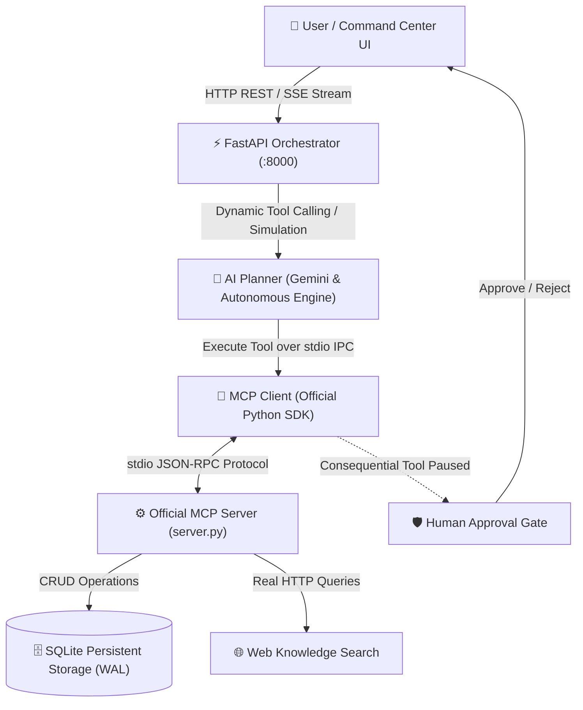

# 🚀 LifePilot AI — Your Personal AI Command Center

[](https://modelcontextprotocol.io/)
[](https://lifepilot-248148494402.us-east1.run.app)
[](https://python.org)
[](https://fastapi.tiangolo.com)
[](https://react.dev)
[](https://sqlite.org)

**LifePilot AI** is a modern, production-grade AI personal command center that interacts with real tools and persistent storage using the official **Model Context Protocol (MCP)** rather than simply generating static text.

🌐 **Live Cloud Run URL**: **[https://lifepilot-248148494402.us-east1.run.app](https://lifepilot-248148494402.us-east1.run.app)**


---

## 🌟 Core Highlights & Architecture



1. **Official Model Context Protocol (MCP) Server**:
   - Implemented using the official Python MCP SDK (`mcp.server.mcpserver.MCPServer`).
   - Exposes 8 structured tools via standard `stdio` transport.
2. **Persistent Storage with SQLite (WAL mode)**:
   - Full persistence for tasks, execution logs, and pending approvals. Data survives restarts.
3. **Intelligent AI Tool Orchestrator**:
   - Analyzes user goals and calls real MCP tools.
   - Supports **Google Gemini API** (`gemini-2.5-flash`, `gemini-1.5-pro`) and an **Autonomous Simulation Engine** with zero hardcoded fake data.
4. **Human-in-the-Loop Safeguards**:
   - Consequential actions (such as `delete_task`) automatically pause execution and create an approval record.
5. **Real-time Live Activity Timeline**:
   - Server-Sent Events (SSE) stream every tool invocation, latency (ms), argument payload, and output to the UI in real-time.
6. **Built-in MCP Inspector**:
   - Dynamically inspects all registered tools, their input schemas, descriptions, and provides an interactive test playground.

---

## 🛠️ Registered MCP Tools

| Tool Name | Consequential | Description |
|---|:---:|---|
| `create_task` | No | Creates a task in persistent SQLite storage with priority, deadline, category, and focus minutes. |
| `list_tasks` | No | Retrieves and filters tasks by status (`all`, `pending`, `completed`), priority, or category. |
| `update_task` | No | Updates task attributes (title, status, due date, priority, category) in SQLite. |
| `delete_task` | **Yes 🛡️** | Permanently deletes a task. Gated by human approval confirmation before execution. |
| `generate_study_plan` | No | Generates a structured multi-day curriculum and automatically creates individual SQLite tasks. |
| `search_web` | No | Performs real-time knowledge queries with live web search and curated documentation fallbacks. |
| `get_productivity_stats` | No | Computes completion rate, focus hours planned vs done, overdue tasks, and queue analytics. |
| `generate_recommendations` | No | Analyzes workload and backlog to generate actionable productivity insights. |

---

## 💻 Quick Start Guide

### 1. Environment Setup

```bash
# Clone or navigate to the project directory
cd /config/Desktop/BuildWithGemini/lifepilot

# Activate the virtual environment
source /config/lifepilot-venv/bin/activate
```

### 2. Configure Environment (Optional)

Copy `.env.example` to `.env`:
```bash
cp .env.example .env
```
To enable live Gemini tool calling, set your key:
```env
GEMINI_API_KEY=your_gemini_api_key_here
GEMINI_MODEL=gemini-2.5-flash
```
> *Note: If no API key is set, LifePilot operates in Autonomous Simulation Engine mode, executing real MCP tools and SQLite writes.*

### 3. Launch the Application

Run the unified launch script:
```bash
./run.sh
```
Or start uvicorn directly:
```bash
/config/lifepilot-venv/bin/uvicorn backend.main:app --host 0.0.0.0 --port 8000
```

Open your browser to: **`http://localhost:8000`**

---

## 🧪 Testing the Official MCP Server Directly

You can test the MCP server in isolation over stdio using the Python MCP client:

```bash
/config/lifepilot-venv/bin/python -c "
import asyncio
from backend.client.mcp_client import mcp_client

async def test():
    # 1. Inspect registered tools over stdio
    tools = await mcp_client.list_tools()
    print(f'Discovered {len(tools)} tools via MCP Protocol')
    
    # 2. Execute create_task tool
    res = await mcp_client.execute_tool('create_task', {
        'title': 'Test MCP Tool Direct Call',
        'priority': 'high',
        'category': 'MCP-Test'
    })
    print('Execution Result:', res)

asyncio.run(test())
"
```

---

## 🎯 Demo Scenario: AI Engineer Interview Prep

To test the end-to-end workflow:

1. Open **`http://localhost:8000`**.
2. Click the quick prompt:
   > **`Help me prepare for an AI Engineer interview in 7 days.`**
3. Click **Execute**.
4. Observe the live orchestrator:
   - Queries web knowledge via `search_web`.
   - Executes `generate_study_plan` over stdio IPC with duration = 7 days.
   - Decomposes into 7 sequential daily milestones.
   - Automatically writes each task to SQLite.
5. Review the results:
   - **Command Tasks**: 7 organized tasks appear on the dashboard with estimated hours, categories, and due dates.
   - **Task Operations**: Edit any task inline, check off completed tasks, or click delete to trigger the **Human Approval Gate**.
   - **Live MCP Timeline**: Watch each tool execution trace with millisecond latency and argument inspection.
   - **Productivity Stats**: Review the velocity progress bar and AI recommendations.

---

## 🔬 Running Automated Test Suite

LifePilot includes an automated test suite verifying SQLite persistence, MCP tool discovery, stdio client communication, approval gating, and the 7-day demo scenario:

```bash
/config/lifepilot-venv/bin/python tests/test_lifepilot.py
```

Expected output:
```
Ran 6 tests in 7.7s

OK
```

---

## 📁 Project Structure

```
lifepilot/
├── backend/
│   ├── client/
│   │   └── mcp_client.py       # Official MCP Client over stdio IPC
│   ├── db/
│   │   └── database.py         # SQLite WAL engine (tasks, logs, approvals)
│   ├── mcp_server/
│   │   └── server.py           # Official Python MCPServer (8 registered tools)
│   ├── services/
│   │   └── planner.py          # Gemini AI Planner & Simulation Orchestrator
│   ├── main.py                 # FastAPI REST + Server-Sent Events (SSE)
│   └── requirements.txt
├── frontend/
│   ├── src/
│   │   ├── api/client.ts       # Typed API client & SSE subscriber
│   │   ├── components/
│   │   │   ├── Header.tsx           # Status bar, navigation, approval alert
│   │   │   ├── ChatPlanner.tsx      # Natural language goal input & prompt chips
│   │   │   ├── TaskDashboard.tsx    # Tasks management, filters, inline edit
│   │   │   ├── ActivityPanel.tsx    # Live MCP Activity timeline & JSON viewer
│   │   │   ├── MCPInspector.tsx     # Tool schema explorer & execution runner
│   │   │   ├── ApprovalModal.tsx    # Human-in-the-loop approval confirmation
│   │   │   ├── AnalyticsCards.tsx   # Productivity metrics & AI insights
│   │   │   └── SettingsModal.tsx    # API key & model settings
│   │   ├── types/index.ts
│   │   ├── App.tsx
│   │   └── index.css
│   ├── package.json
│   └── vite.config.ts
├── tests/
│   └── test_lifepilot.py       # Automated test suite
├── run.sh                      # Launch script
└── README.md
```

---

## 🛡️ License

Built with Google Gemini & Model Context Protocol. Open-source under Apache 2.0.
